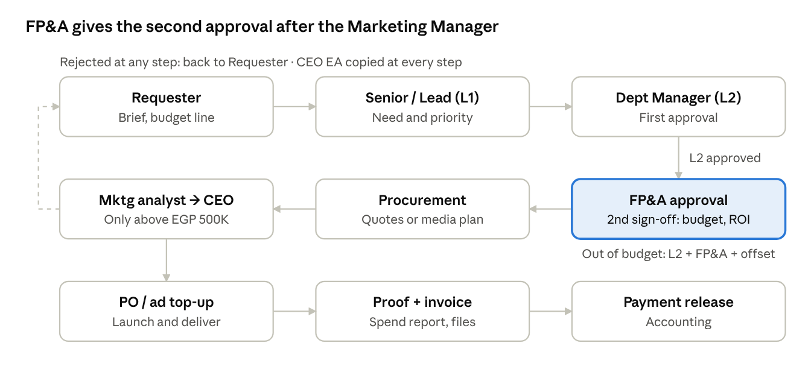
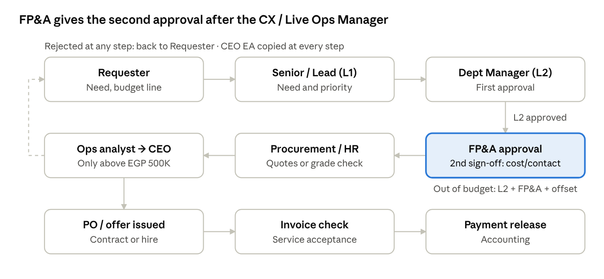

# Golden Collection – Approval Cycle Policy (Marketing & Operations)

Oct 13, 2026 · @ahmed hossam

## Purpose, scope and principles

Every Marketing and Operations commitment above EGP 5K is approved by
the Department Manager (L2) first and then gets a second approval from
FP&A before any commitment, with Accounting running invoices and
payments, and approval authority rises with value across five EGP bands.
This policy covers four request types: spend and purchase requests,
payments and invoices, campaigns and promotions, and operational changes
including hiring.

Principles:

- **No commitment before approval.** No PO, vendor confirmation or offer
  letter is issued until the final approver signs.

- **Segregation of duties.** The requester never approves their own
  request; the person who approves a purchase does not release its
  payment.

- **Budget linkage.** Every request carries a budget line; FP&A confirms
  remaining budget as part of its second approval.

- **Lowest sufficient level.** A request goes only as high as its value
  band requires, keeping cycle times short.

- **Works without ERP.** The cycle runs on a standard request form,
  email sign-off and a shared approval log, so it can start immediately.

## Approval roles

Seven roles carry the cycle; titles can be mapped to Golden Collection's
actual org chart.

| Role                    | Who (Marketing)                                                 | Who (Operations)                                | Responsibility in the cycle                                                                                                                                                                                                         |
|-------------------------|-----------------------------------------------------------------|-------------------------------------------------|-------------------------------------------------------------------------------------------------------------------------------------------------------------------------------------------------------------------------------------|
| Requester               | Media buyer, marketing executive or designer                    | CX or live ops agent / team member              | Raises the request with quotes, budget line and business case                                                                                                                                                                       |
| Senior / Lead (L1)      | Senior media buyer, senior marketing executive or lead designer | Senior agent or team lead, logistics / live ops | Confirms need, scope and priority                                                                                                                                                                                                   |
| Department Manager (L2) | Marketing Manager                                               | CX / Live Ops Manager                           | First approval; owns the department budget                                                                                                                                                                                          |
| FP&A (second approver)  | FP&A                                                            | FP&A                                            | Second sign-off after L2 on every request: budget availability, cost coding, ROI or cost-per-contact impact; co-approves Band C and out-of-budget items                                                                             |
| Procurement             | Procurement Officer                                             | Procurement Officer                             | Confirms vendor, 3 quotes above EGP 100K, contract terms                                                                                                                                                                            |
| Accounting              | Accounting                                                      | Accounting                                      | Runs all financial operations: receives invoices (AP inbox), 3-way match, ad account top-ups, advances and payment runs; does not approve spend                                                                                     |
| Strategy Analysts       | Strategy Analyst – Marketing                                    | Strategy Analyst – Ops                          | Reviews every request above EGP 500K from their department for fit with company strategy and priorities; sends a recommendation to the CEO through the EA; does not approve. Each analyst covers the other's department when absent |
| CEO                     | CEO                                                             | CEO                                             | Final authority above EGP 500K and for new headcount outside plan                                                                                                                                                                   |
| CEO Executive Assistant | CEO Executive Assistant                                         | CEO Executive Assistant                         | Copied at every stage; can pull any request to the CEO's attention at any point; manages the CEO approval queue and its SLA; does not approve                                                                                       |

HR joins every hiring request after L1 to confirm grade, salary band and
headcount plan.

**CEO Executive Assistant at every stage.** The EA is copied on every
request from submission to payment through the approval log. At any
stage the EA can flag a request for CEO attention, put it on hold
pending a CEO question, or fast-track it, and is the single channel
through which Strategy-reviewed requests reach the CEO.

## Delegation of Authority matrix

The final approver is set by request type and value band; every request
first passes Requester → L1 → L2 → FP&A (second approval) → Procurement
where relevant; Strategy and the CEO sign only above EGP 500K, and
Accounting processes the payment; the CEO Executive Assistant is copied
at every step. Values are per request, EGP incl. VAT; splitting one need
into smaller requests to stay under a band is a policy breach.

| Request type                                                              | Band A: ≤ 25K    | Band B: 25K–100K | Band C: 100K–500K | Band D: 500K–1.5M | Band E: \> 1.5M         |
|---------------------------------------------------------------------------|------------------|------------------|-------------------|-------------------|-------------------------|
| Opex purchase, in budget                                                  | L1 Senior / Lead | L2 Dept Manager  | L2 Dept Manager   | L2 + FP&A (2nd)   | Strategy → CEO          |
| Capex purchase, in budget                                                 | L2 Dept Manager  | L2 Dept Manager  | L2 + FP&A (2nd)   | Strategy → CEO    | Strategy → CEO          |
| Marketing campaign / activation                                           | L1 Senior / Lead | L2 Dept Manager  | L2 + FP&A (2nd)   | Strategy → CEO    | Strategy → CEO          |
| Trade promotion / discount                                                | L2 Dept Manager  | L2 Dept Manager  | L2 + FP&A (2nd)   | Strategy → CEO    | Strategy → CEO          |
| Ops change: CX tools, BPO / outsourced agents, shift or workforce changes | L1 Senior / Lead | L2 Dept Manager  | L2 + FP&A (2nd)   | Strategy → CEO    | Strategy → CEO          |
| Out-of-budget item (any type)                                             | L2 + FP&A (2nd)  | L2 + FP&A (2nd)  | L2 + FP&A (2nd)   | Strategy → CEO    | Strategy → CEO          |
| Payment processing (Accounting, after approval)                           | Accounting       | Accounting       | Accounting        | Accounting        | Accounting + CEO (dual) |

Fixed rules regardless of value:

- **Hiring within approved headcount plan:** L2 Dept Manager + HR.
  Hiring outside plan or above salary band: Strategy review, then CEO.

- **Contracts over 12 months or with auto-renewal:** L2 + FP&A second
  approval minimum.

- **Discounts deeper than the approved price-list corridor:** L2 + FP&A
  second approval, with a margin impact (bps) from FP&A.

- **Procurement:** 1 quote ≤ 25K, 2 quotes 25K–100K, 3 quotes \> 100K or
  a documented single-source justification.

## Marketing approval cycle

Marketing requests come from three roles — media buyers, marketing
executives and designers — and all follow the same nine steps: L2
approves first and FP&A gives the second approval, Procurement is
skipped for Band A, Strategy and the CEO sign only above EGP 500K, and
Accounting handles invoices and payments.

Marketing approval flow · 8 steps

Proof of execution (ad platform spend reports, media log, delivered
design files or print proofs) replaces the goods received note, and
campaigns in Band C and above get a post-campaign ROI review within 30
days of closing.

How each Marketing role uses the cycle:

| Role                | Typical requests                                                                  | What approval covers                                                                    | Specific rules                                                                                                                                                                                                                                           |
|---------------------|-----------------------------------------------------------------------------------|-----------------------------------------------------------------------------------------|----------------------------------------------------------------------------------------------------------------------------------------------------------------------------------------------------------------------------------------------------------|
| Media buyer         | Paid media on ad platforms (Meta, Google, TikTok), influencers, media agency fees | A monthly media plan by platform and campaign, approved per DoA band on its total value | Ad platforms are single-source, so no 3 quotes; Accounting tops up prepaid ad accounts only against the approved plan; the Senior media buyer may shift up to 15% between platforms or campaigns within the plan total; anything above needs re-approval |
| Marketing executive | Campaigns, activations, events, sponsorships, promotional giveaways               | Each campaign as one request with brief, budget and expected ROI                        | All costs of one campaign go on one request (no splitting); post-campaign ROI review for Band C and above                                                                                                                                                |
| Designer            | Freelancers, printing and production, stock assets, design software licences      | Per job, or an annual request for recurring licences                                    | Freelancers on an approved rate card can be engaged by the Lead designer within Band A; software licences are opex and renew only with L2 approval                                                                                                       |

## Operations (CX & Live Ops) approval cycle

Ops requests follow the same nine steps, with L2 approving first and
FP&A giving the second approval; FP&A tests cost per contact and CX
service-level impact instead of campaign ROI, and HR replacing
Procurement for hiring.

Operations approval flow · 8 steps

For CX tools, BPO contracts and workforce changes (new shifts, overtime,
temporary agents), FP&A shows the cost per contact and cost per agent
before and after, alongside the expected effect on SLA, first response
time and CSAT. Emergency Ops requests (platform outages, backlog spikes)
use the fast track in the SLA section.

## Payments and invoices

An invoice is paid only when it matches an approved request (PO), a
receipt confirmation and the invoice itself — the 3-way match.

1.  **Vendor submits invoice** to Accounting (one shared AP inbox),
    never directly to Marketing or Ops.

2.  **Receipt confirmation** by the requesting department: service
    acceptance for Ops (vendor SLA report, licence activation or BPO
    timesheets), proof of execution for Marketing (ad platform spend
    reports, media log, delivered design files or print proofs).

3.  **Accounting 3-way match:** approved request ↔ receipt ↔ invoice.
    Variance tolerance: ±2% or EGP 5K, whichever is lower.

4.  **Variance above tolerance** goes back to the original approver for
    re-approval of the difference; above 10%, it follows the DoA band of
    the new total.

5.  **Payment release** by Accounting once the request carries all
    approvals in the matrix, on the next weekly payment run (proposed:
    Thursday).

Advance payments above EGP 100K need L2 + FP&A second approval and a
signed contract; advances to agencies are capped at 50% of contract
value.

## SLAs, escalation and exceptions

Each approval step has a 1–2 working-day clock, so a Band C request
should close within 7 working days end to end.

| Step                                       | SLA (working days)      | If missed                                                          |
|--------------------------------------------|-------------------------|--------------------------------------------------------------------|
| L1 Senior / Lead                           | 1                       | Auto-escalates to L2 Dept Manager                                  |
| L2 Dept Manager                            | 2                       | Reminder, then CEO Executive Assistant informed                    |
| FP&A second approval                       | 2                       | Reminder, then CEO Executive Assistant informed                    |
| Procurement (quotes)                       | 3                       | Escalates to FP&A                                                  |
| Strategy Analyst review (Marketing or Ops) | 2                       | CEO Executive Assistant escalates to CEO                           |
| CEO                                        | 3                       | CEO Executive Assistant raises it in the weekly management meeting |
| Accounting (match and payment)             | Next weekly payment run | Escalates to FP&A                                                  |

**Rejected or returned requests** go back to the Requester with a
written reason; resubmission restarts at the rejecting step, not at the
beginning.

**Emergency requests** (e.g. CX platform or telephony outage, sudden
ticket or call backlog needing overtime or temporary agents): the L2
Dept Manager may give verbal or WhatsApp approval up to Band C, with the
full form and FP&A second approval completed within 2 working days.
Emergency use is reported monthly; more than 3 per department per month
triggers a review.

**Out-of-budget requests** must name the offset: a saving elsewhere in
the department budget, a reallocation, or an incremental ask approved by
L2 + FP&A (Strategy and CEO above EGP 500K).

## Documentation, approval log and controls

Every request lives as one row in a shared approval log (Excel or Google
Sheet) with a unique ID, and each sign-off is an email reply quoting
that ID.

**Request form — minimum fields:** request ID (e.g. MKT-2026-041 /
OPS-2026-112), department, request type, description, vendor, value
excl. and incl. VAT, budget line and remaining budget, business case
(expected ROI for Marketing; cost per contact and impact on CX KPIs
(SLA, first response time, CSAT) for Ops), attachments (quotes, brief,
contract draft).

**Approval log columns:**

| Request ID   | Date raised | Dept      | Type     | Value (EGP) | Band | Budget line         | In budget? | Current step | Approver   | Approval date | Status  | PO / payment ref |
|--------------|-------------|-----------|----------|-------------|------|---------------------|------------|--------------|------------|---------------|---------|------------------|
| MKT-2026-041 | 13 Oct 2026 | Marketing | Campaign | 180,000     | C    | Trade activation Q4 | Yes        | FP&A (2nd)   | FP&A (2nd) | —             | Pending | —                |

Monthly controls run by FP&A, with Accounting data:

- Spend without an approved request ID (target: 0)

- Split requests: same vendor, same department, within 30 days, combined
  value crossing a band

- Cycle time per step versus SLA, by department

- Emergency approvals count and value

- Approved versus actual spend per campaign (post-campaign ROI review
  for Band C and above)

## Assumptions

The EGP bands are a starting proposal sized for a mid-size Egyptian FMCG
distributor and should be calibrated to Golden Collection's actual spend
profile before sign-off.

**Key assumptions**

- Each department has Seniors / Leads (L1) reporting to a Department
  Manager (L2), who reports to the CEO; there is no CFO, so FP&A acts as
  second approver, Accounting runs invoices and payments, a Strategy
  team reviews CEO-level items, and the CEO Executive Assistant
  coordinates CEO approvals.

- An approved annual budget exists by department and cost line; FP&A can
  report remaining budget weekly.

- Bands assume roughly 70–80% of request count falls in Bands A–B, so
  most requests close at department level.

- Values include VAT; recurring contracts are valued at their total
  contract value, not the monthly amount.
